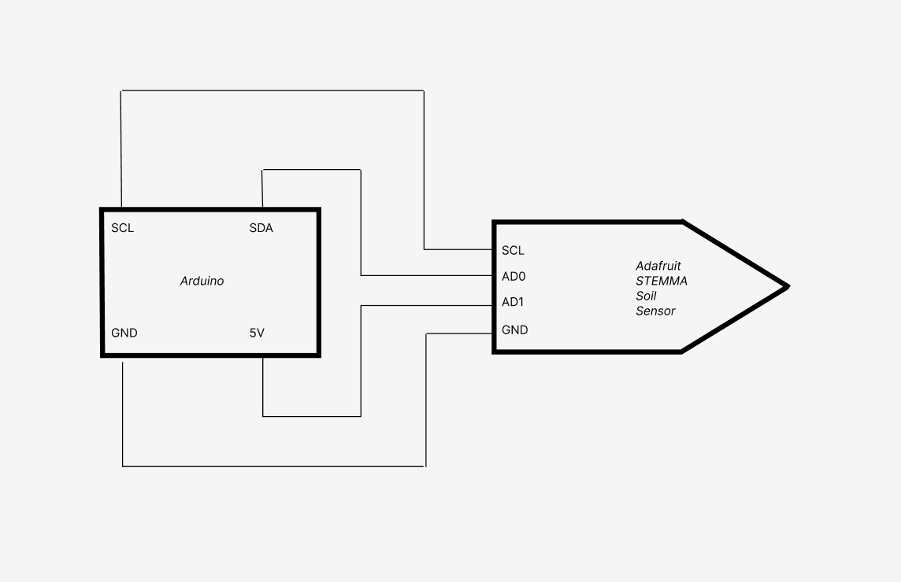
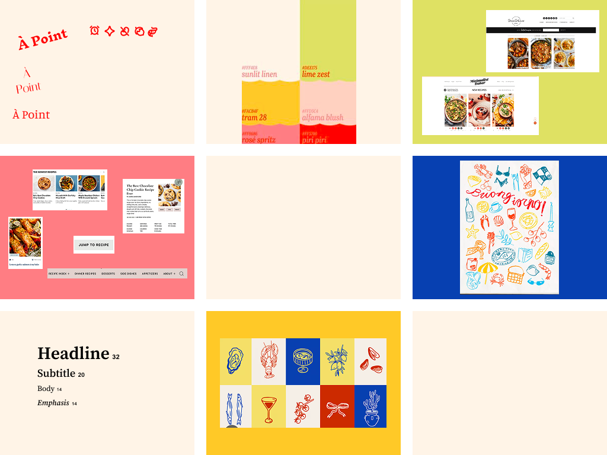
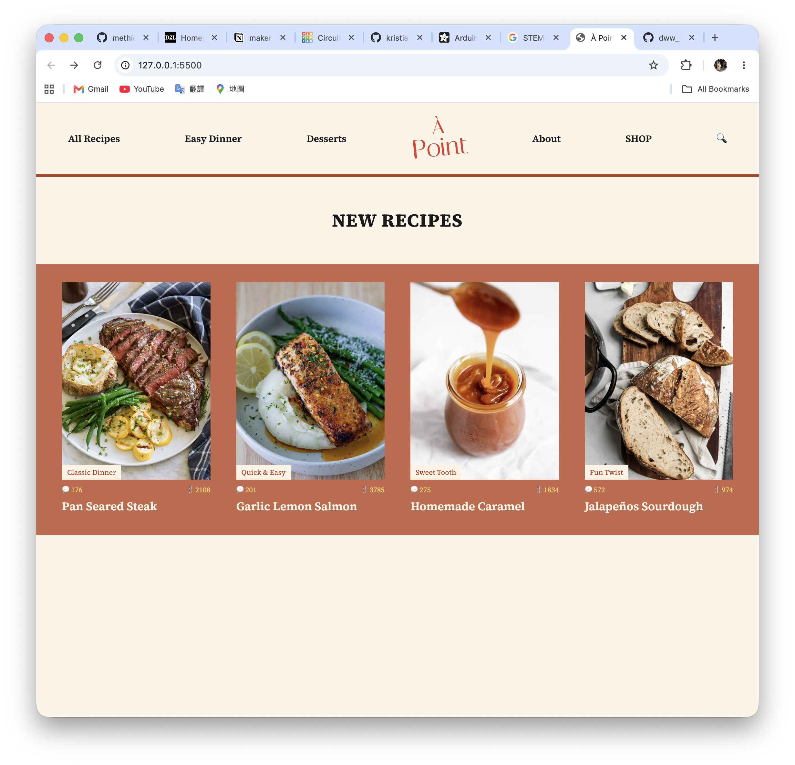
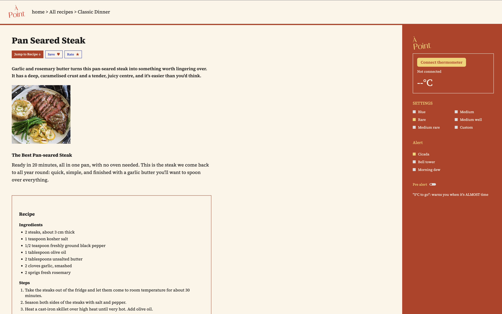

# MITID Assignment LEXI CHU

## À Point
### Personalized multifunctional kitchen therometer. 
My project consists of one temperature detector and a recipe website (but not only recipes!!). On the website, once you click into the recipe that you want, you'll find the settings panel for the thermometer. This is where the magic happens! For example, in the Pan Seared Steak recipe, you can choose the doneness of the steak (Blue, Rare, Medium rare, Medium, Medium well, Custom). The system will automatically set the thermometer to the appropriate center temperature. For instance, if you picked Medium rare, the device will be set to beep at 57C. As a bonus, there is the possibility to pick your preferred ringtone. Furthermore, you also have the option to get a pre-alert, meaning that you will get a “5°C to go” warning when it’s ALMOST time.

## Schematic view
<picture>
    
</picture>

## Moodboard
<picture>
    
</picture>

### Figma UI
(https://www.figma.com/design/5iDQRk1PTeJPNLQgBVcobV/ChihYi-CHU_dww_project?node-id=1-47&t=gzf6IIDxuA65nfsc-1)

## Website 
<picture>
    
</picture>

<picture>
    
</picture>
